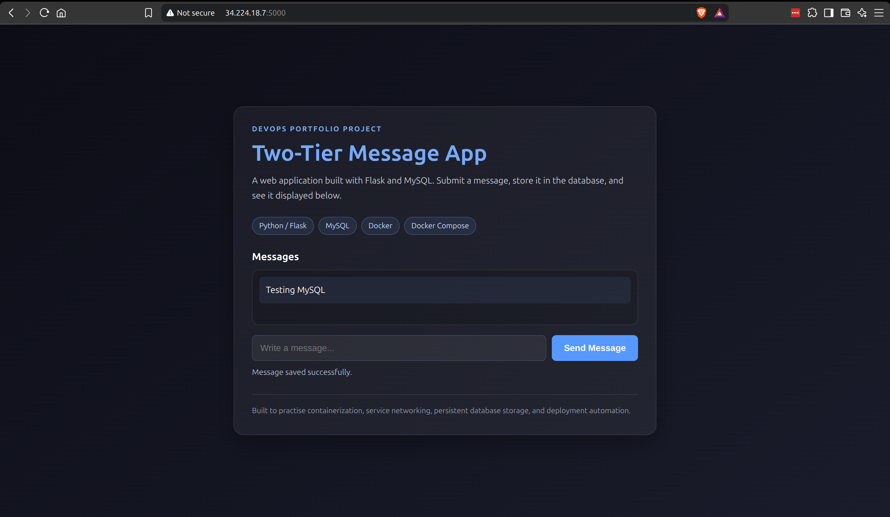

# Two-Tier Flask and MySQL App on AWS

I used this project to practice containerizing a small web application and deploying it to one AWS EC2 instance with Jenkins.

The app has two tiers:

- **Web tier:** a Python Flask app that displays and accepts messages.
- **Database tier:** MySQL, which stores the messages.

Docker Compose runs both services on a private Compose network. A named volume keeps MySQL data when containers are recreated. Jenkins checks out the `main` branch and runs the Compose deployment command on the EC2 host.

This is a learning project. The Flask development server is run with debug enabled, and the app is exposed directly on port 5000. It is not configured as a production service.

## Architecture

```text
GitHub repository (main)
          |
          | Jenkins checks out main
          v
 Jenkins pipeline on EC2
          |
          | docker compose --env-file /etc/two-tier-app/.env up -d --build
          v
 One EC2 instance / Docker Engine
 +--------------------------------+
 | Flask container :5000          |
 |         |                      |
 |         | private Compose net  |
 |         v                      |
 | MySQL container                |
 |         |                      |
 | named mysql_data volume        |
 +--------------------------------+
```

The Flask container connects to MySQL by the Compose service name `mysql`. The database is not published on a host port in the current Compose file.

## What I implemented and learned

- Built and ran a Flask + MySQL two-tier application with Docker and Docker Compose.
- Used Compose environment variables to configure MySQL and the Flask database connection.
- Kept MySQL files in the named `mysql_data` volume so they survive container replacement.
- Stored the EC2 deployment environment file at `/etc/two-tier-app/.env`; it is not committed to Git.
- Added a MySQL health check and made the Flask service wait for MySQL to become healthy.
- Added bounded database initialization retries in `app.py` (up to 10 attempts, two seconds apart) to handle MySQL taking time to start.
- Configured Jenkins to check out `main` and run `docker compose --env-file /etc/two-tier-app/.env up -d --build` on the EC2 host.
- Troubleshot out-of-memory failures on `t3.micro` by upgrading the instance to `t3.medium` for this run.
- Fixed a stale MySQL credential issue in a disposable test environment by recreating its volume. MySQL keeps initialized users and passwords in its data directory, so changing environment variables alone does not rewrite credentials in an existing database volume.

## Repository files

```text
.
├── app.py                 # Flask routes and database initialization/retries
├── templates/index.html   # Message form and message list
├── Dockerfile             # Flask image build
├── docker-compose.yml     # Flask, MySQL, network, health checks, and volume
├── Jenkinsfile            # Checkout main and deploy with Docker Compose
├── requirement.txt        # Python dependencies
└── .env.example           # Variable names and placeholder values for local use
```

## Prerequisites

- Git
- Docker Engine and the Docker Compose plugin
- For AWS deployment: an Ubuntu EC2 instance, Jenkins, and a Jenkins agent running on that same instance
- The Jenkins agent needs permission to run Docker commands and read `/etc/two-tier-app/.env`
- Security group access limited to the people who need it: SSH (22), Jenkins (8080), and the app (5000)

The deployment used a single `t3.medium` EC2 instance after `t3.micro` ran out of memory during this project. Instance sizing depends on workload and is not a general production recommendation.

## Run locally with Docker Compose

1. Clone the repository and enter its directory:

   ```bash
   git clone https://github.com/adityasingh307/DevOps-Project-Two-Tier-Flask-App.git
   cd DevOps-Project-Two-Tier-Flask-App
   ```

2. Create a local environment file from the example and replace the placeholder passwords:

   ```bash
   cp .env.example .env
   ```

   `.env` is ignored by Git. Do not commit real credentials.

3. Build and start the services:

   ```bash
   docker compose --env-file .env up -d --build
   ```

4. Check the services and app endpoint:

   ```bash
   docker compose ps
   curl -f http://localhost:5000/health
   ```

   Open `http://localhost:5000` to submit a message and see saved messages.

5. Follow logs or stop the containers:

   ```bash
   docker compose logs -f flask-app mysql
   docker compose down
   ```

`docker compose down` keeps the named database volume. To remove local data as well, see the warning in [Troubleshooting](#troubleshooting).

## Deploy on one EC2 instance with Jenkins

The Jenkins agent and the Docker Compose deployment target must be the same EC2 host for the current `Jenkinsfile`: `agent any` runs the shell step on an available agent, and Compose acts on that agent's local Docker daemon.

### Prepare the host

Install and start Docker Engine, the Docker Compose plugin, Java, and Jenkins on the EC2 instance. Give the Jenkins agent permission to use Docker. For a Jenkins service account named `jenkins`, the typical host setup is:

```bash
sudo usermod -aG docker jenkins
sudo systemctl restart jenkins
```

Group membership grants broad control over the host through Docker, so use it only for a trusted Jenkins agent.

Create the environment file on the EC2 instance. Use strong, unique values and keep the file out of the repository:

```bash
sudo install -d -o root -g jenkins -m 0750 /etc/two-tier-app
sudoedit /etc/two-tier-app/.env
```

The file should contain the variables used by `docker-compose.yml`:

```dotenv
MYSQL_ROOT_PASSWORD=replace_with_a_strong_root_password
MYSQL_DATABASE=devops
MYSQL_USER=appuser
MYSQL_PASSWORD=replace_with_a_strong_app_password
```

Allow the Jenkins service account to read the file without making it world-readable:

```bash
sudo chown root:jenkins /etc/two-tier-app/.env
sudo chmod 0640 /etc/two-tier-app/.env
```

The real file stays on the EC2 host at `/etc/two-tier-app/.env`; only `.env.example` with placeholders belongs in Git. Never paste secrets into the Jenkinsfile or screenshots.

### Configure and run Jenkins

Create a Jenkins Pipeline job configured to use this repository and the `Jenkinsfile` script path. The current pipeline checks out the `main` branch and runs:

```bash
docker compose --env-file /etc/two-tier-app/.env up -d --build
```

Run the job and review its stage result and console output. Automatic deployment on every push depends on the Jenkins trigger or webhook configuration; the Jenkinsfile itself does not configure a webhook.

After a successful run, check the containers on the EC2 host:

```bash
docker compose --env-file /etc/two-tier-app/.env ps
docker compose --env-file /etc/two-tier-app/.env logs --tail=100 flask-app mysql
```

Open `http://<EC2-public-address>:5000` if the instance security group allows access from your client IP. Do not expose MySQL port 3306 to the internet.

## Security notes

- `/etc/two-tier-app/.env` contains database credentials and must stay on the host. The repository's `.gitignore` excludes `.env` files; `.env.example` uses placeholders.
- Restrict SSH, Jenkins (8080), and the app (5000) to trusted source addresses where possible. The current app uses HTTP directly and has no TLS termination.
- The Dockerfile starts Flask with `debug=True`. Keep this setup for learning only; do not expose the development server as a production service.
- The `/health` endpoint returns an app response; it does not check whether MySQL queries are succeeding. The Compose health-check command for Flask uses `curl`, but the current Dockerfile does not install `curl`, so check this dependency if Compose reports the Flask container as unhealthy.
- The Compose file uses a named volume for database persistence. Protect and back up database data if it matters.

## Troubleshooting

### Flask cannot connect to MySQL during startup

Check the MySQL container and its health status:

```bash
docker compose --env-file /etc/two-tier-app/.env ps
docker compose --env-file /etc/two-tier-app/.env logs mysql
```

Compose waits for the MySQL health check before starting Flask. The app also retries database initialization up to 10 times with a two-second delay. These retries are bounded; if MySQL is still unavailable, inspect the logs and fix the underlying issue.

### MySQL reports an old password after changing `.env`

The official MySQL image applies initialization variables when it creates a new database data directory. An existing `mysql_data` volume already contains the database users and passwords, so editing `.env` alone does not update those stored credentials. For a real database, change the MySQL user password in MySQL and update the app configuration to match.

For a **disposable test database only**, removing the volume forces MySQL to initialize from the current environment file again. This permanently deletes messages and other data in that volume:

```bash
docker compose --env-file /etc/two-tier-app/.env down -v
docker compose --env-file /etc/two-tier-app/.env up -d --build
```

Do not run `down -v` on data you need to keep.

### Docker build or services run out of memory

During this project, the `t3.micro` instance ran out of memory; upgrading the test host to `t3.medium` resolved the issue for this deployment. Check EC2 memory and container logs before changing instance size, and remember that resizing affects AWS cost.

### Jenkins cannot read the environment file or Docker daemon

Confirm the pipeline runs on the EC2 agent, the `jenkins` user can read `/etc/two-tier-app/.env`, and the Jenkins service has restarted after Docker group membership changed. The Compose command uses an absolute environment-file path, so the file must exist on that agent host.

## Screenshots to capture before stopping or cleaning up AWS

Create a `screenshots/` folder in the repository and save these images with the exact names below:

1. [ ] `screenshots/01-working-app.png` — browser showing the Flask app with a submitted message displayed from MySQL.
2. [ ] `screenshots/02-jenkins-success.png` — Jenkins build number and successful pipeline stage view. Include enough of the result to show the deployment completed.
3. [ ] `screenshots/03-jenkins-console.png` — console output showing checkout of `main` and the Docker Compose deployment command. Crop or redact credentials, tokens, and other secrets.
4. [ ] `screenshots/04-ec2-instance.png` — EC2 instance details showing the instance type (`t3.medium`) and running state. Hide account identifiers and public IP if posting publicly.
5. [ ] `screenshots/05-compose-services.png` — terminal output from `docker compose --env-file /etc/two-tier-app/.env ps` showing the Flask and MySQL services running. Do not show the `.env` contents.
6. [ ] `screenshots/06-security-group.png` — optional security group inbound rules showing intended source restrictions and no public MySQL port.

The first five are the recommended project record; the security group image is optional. Capture them before stopping or cleaning up AWS. Review each image for secrets and identifying details before uploading it to this repository. Once uploaded, link them here, for example:

```markdown

```

## What I would improve next

- Disable Flask debug mode and use a production WSGI server before any production deployment.
- Add a proper TLS-enabled reverse proxy and restrict direct access to the Flask port.
- Move secrets into a dedicated secrets manager for a longer-lived deployment.
- Add application tests and a Jenkins validation stage before deployment.
